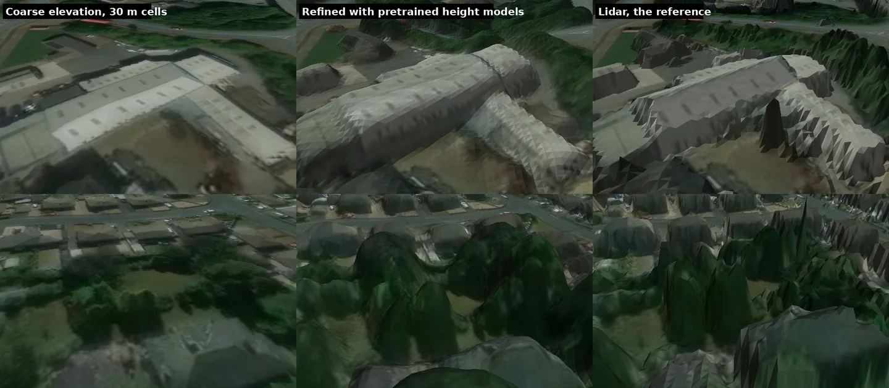
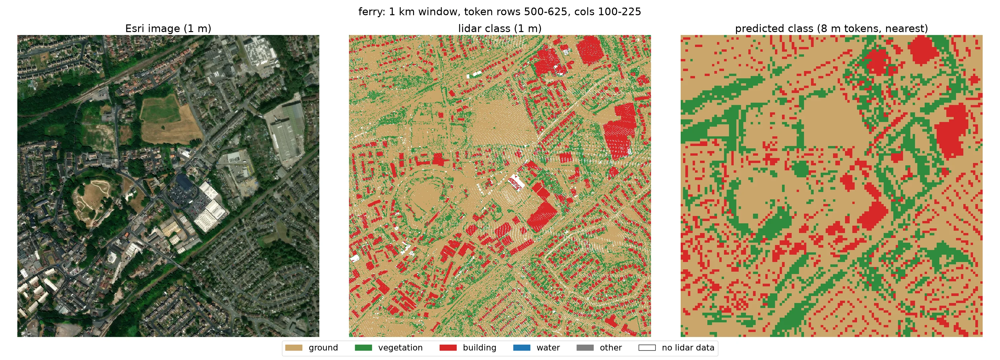

# satmesh

Textured 3D terrain meshes from Esri World Imagery tiles and DEMs, enhanced with classical processing
and ML. Research use.

- `pipeline/`: tile and DEM fetching, meshing, texture draping and export.
- `ml/`: research code for refining coarse elevation with ML (PixTransform, kriging, a file contract
  with the pipeline).

## Setup

Needs [uv](https://docs.astral.sh/uv/); `make` runs [prek](https://prek.j178.dev/) through `uvx`.

```sh
make setup
```

## Demo

<!-- Recorded demo: add docs/demo.mp4, then replace the line below with [Demo video](docs/demo.mp4). -->

Demo video: `docs/demo.mp4` (to be added)

## How it works

1. **Plan:** the two corners become a box in the area's metric CRS (British National Grid in Great
   Britain, else the UTM zone), cut into leaves of 4 x 4 Esri tiles (about 180 m); parents are
   added where all four children exist.
2. **Fetch:** Esri tiles and the elevation sources the registry picks for the area (below),
   cached, throttled and fetched ahead of the node being built.
3. **Mesh:** heights are sampled every 0.5 m in true-metre local coordinates through the source's
   geoid (OSGM15 for England, EGM2008 for the global sources),
   triangulated to a 0.1 m height error with skirts between tiles, and draped with the imagery;
   each node also keeps its ground grid.
4. **Measure the imagery position** (`correct`): windows of imagery are matched to the lidar
   intensity, and roofs to the lidar surface, to find each satellite capture's ground shift and
   lean.
5. **Apply it:** every vertex's texture coordinate moves by shift plus lean times its height, and
   each tile gets a 95 % position-error bound.
6. **Export:** 3D Tiles, Gazebo and GLB are thin views of the one store.

## Use

Needs the PROJ datum grids (`make setup` fetches all of them; `make grids REGIONS="gb us"`
fetches only the named regions `gb`, `global`, `us`). Imagery is Esri World Imagery everywhere,
never finer than 30 cm: a finer local flight is fetched at the 30 cm zoom.
Heights come from the first registry entry that covers the area
(`pipeline/packages/satmesh-data/src/satmesh_data/registry.toml`):

| Area | Surface (visual mesh) | Ground (collision, ground grid) |
| --- | --- | --- |
| England | Environment Agency 1 m first-return DSM | EA 1 m DTM |
| Contiguous United States | USGS 3DEP lidar: 1 m first-return DSM rasterised from EPT point clouds | USGS 3DEP 1 m DEM (1/3 arc-second where no 1 m exists) |
| Middle East (lon 34 to 60, lat 12 to 38) | Copernicus GLO-30 (30 m DSM) | FABDEM V1-2 (30 m bare earth, non-commercial licence) |
| Elsewhere | Copernicus GLO-30 | the same surface, recorded as `ground_is_surface` |

Outside England the heights are 30 m data meshed at 0.5 m, so buildings and trees appear only as
far as the 30 m model carries them. The build logs the source and attribution of every store.
In the United States the heights are 1 m lidar products, so buildings and trees carry their
relief; the build fetches the point clouds and takes minutes per square kilometre on a cold cache.
`satmesh correct` (imagery position from lidar) is England only; elsewhere the exports report
Esri's stated imagery accuracy as the position bound.

The area is two corners, north-west and south-east, as `lat, lon` text copied from a map. Run
everything from `pipeline/`. Outputs go in `uncommitted/`, which git ignores.

```sh
cd pipeline

# 1. Build a tile store for a 500 m square (resumable; fetched data is cached)
uv run satmesh build --nw "53.925897, -2.005297" --se "53.921403, -1.997683" --store ../uncommitted/my_area/store

# 2. Move the imagery to its true position (England only; downloads lidar on first use);
#    elsewhere every tile carries Esri's stated position accuracy as its error bound
uv run satmesh correct --store ../uncommitted/my_area/store

# 3. Export for a consumer
uv run satmesh export 3dtiles --store ../uncommitted/my_area/store
uv run satmesh export gazebo --store ../uncommitted/my_area/store --out ../uncommitted/my_area/gazebo
uv run satmesh export glb --store ../uncommitted/my_area/store --out ../uncommitted/my_area/area.glb
```

`3dtiles` writes `tileset.json` into the store; serve the store directory to open it in CesiumJS.
`gazebo` writes `world.sdf` and its meshes. `glb` writes every finest-level tile as one GLB in a
single local frame, for renderers.

`build` and `correct` show a progress bar per step, and every command that takes `--store`
appends to `run.log` in the store (command line, versions, settings, timings, and for `correct`
each cell's shift and bound and each capture's lean).

`correct` moves the Esri imagery to its true position: it sits 0.2 to 2.8 m off in England, and
roofs and tree crowns lean further the taller they are. It downloads lidar (100 to 500 MB per 5 km
square, cached) and needs about 2 GB per cell it measures in parallel. Every export writes
`positional_error.json` with a 95 % error bound per tile. England only; `--no-lean` skips the lean.

Fetched data is cached under `~/.cache/satmesh` (`--cache-dir` or `SATMESH_CACHE_DIR`). Esri tiles
come at 20 requests per second by default; `--esri-requests-per-second` changes it. Details:
[docs/01-pipeline.md](docs/01-pipeline.md).

## Research results

The build above is the shipped baseline. These results come from England, where Environment Agency
lidar gives a reference to compare against. None of them is in `satmesh build` yet.

### Buildings and trees from one satellite image

A coarse elevation model has no buildings or trees: here, 30 m cells, the resolution of the global
GLO-30 model that covers places without lidar. Pretrained models that read the satellite image and
predict height above ground can put them back: Geopose and RS3DAda for buildings, CHMv2 for trees.
Added to the coarse elevation as a smooth anomaly that keeps the average of every 30 m cell, they
give the middle column. It has the footprints, positions and rough heights of the lidar (right),
where the coarse model alone (left) is flat. It still rounds walls and roof ridges and sits below
the true height; cleaning that up is the next step.



Ferrybridge, West Yorkshire. Imagery © Esri and its data sources. Lidar: contains Environment Agency
information © Environment Agency and/or database right, Open Government Licence v3.

### Land cover from frozen features

A frozen DINOv3 satellite model with a small head, trained on lidar point classes in two areas and
tested on the third, finds buildings (F1 0.73 to 0.82) where a colour-only classifier does not
(0.16 to 0.32), including grey roofs beside grey pavement. Vegetation is weaker (F1 0.14 to 0.31)
and each prediction covers an 8 m square. The classes are meant to keep ground flat and to tidy
roofs, walls and tree crowns in the height step above.



Ferrybridge, 1 km window, left to right: image, lidar classes, predicted classes. Sources as above.

## Planned

- Building and tree height inside `build`, from pretrained models on the coarse elevation, with
  land cover keeping ground flat and tidying roofs, walls and tree crowns.
- Terrain beyond about 6 km, with averaged coarse tiles.
- A lighter Gazebo collision mesh and a test in a running simulator.
- A real-photo localisation test, and imagery correction outside England.

## Checks

```sh
make check
```
